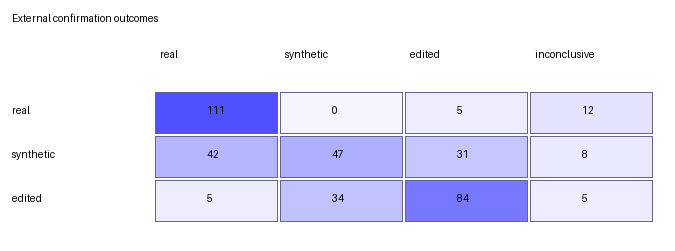

# Prospective hierarchical external confirmation

This document records the prospective confirmation experiment for the learned
hierarchical aggregation policy (`c1214e33d698daa7cda082cd2c20ef0e4553d8d63b46ac77494e9685a50a1187`),
specified in [`hierarchical-external-confirmation-plan.md`](hierarchical-external-confirmation-plan.md).
The candidate catalog and external manifest were verified, audited, and frozen
before running either detector adapter on any confirmation image.

The confirmation protocol is strictly evaluation-only: it fitted no model
coefficients, selected no new decision thresholds, and modified no feature
definitions.

## 1. Frozen confirmation evidence

- **Protocol**: `diffdetect-hierarchical-external-confirmation-v1`
- **Total samples**: 384 images (128 `real`, 128 `synthetic`, 128 `edited`)
- **Candidate catalog SHA-256**:
  `569c68cde4b6b980f910bd74b3e33957c953277416395f0590fcb5aabb05af3e`
- **External manifest SHA-256**:
  `d901cd8e4ee5211399b50be579dda23c3814601da6763e2e46547f753c6a77a4`
- **Raw results CSV SHA-256**:
  `9fd19aab8d9ecfe14006471c21cb2d31d222aacacb1f6b05699d1996ba35ac3a`
- **Raw results metadata SHA-256**:
  `07dd7f2ab13816caf8ec361fc55d827a8aea1eb6af40a2cd047f362fd18de6a2`
- **DistilDIRE execution errors**: 0
- **DinoLizer execution errors**: 0
- **Exclusion manifests verified**:
  - `three-class-validation-manifest.csv` (`9dcda4b93d8c73df7b1240629bec209566cd6119bb7f800c2906b8c3826b8777`)
  - `hierarchical-calibration-manifest.csv` (`5a23bee4f802b9c88dd41030711aee173d27a3f8974371153439c0c363cde3a5`)
- **Overlap with earlier experiments**: 0 sample identifiers, source identifiers,
  image hashes, or derivative origin hashes.

Inference completed on a Tesla T4 GPU with 14.56 GB VRAM, using Python 3.12,
PyTorch 2.5.1+cu124, torchvision 0.20.1+cu124, and CUDA 12.4. Total detector
execution time was 12.26 minutes (~1.92 seconds per sample after initial model
loading).

## 2. End-to-end confirmation results

All 384 samples remain in the denominator. Abstentions (inconclusive decisions)
are counted as incorrect predictions for accuracy, balanced accuracy, recall,
and macro F1.

| Metric | Boolean baseline (768 imgs) | Calibration OOF (768 imgs) | External confirmation (384 imgs) |
| :--- | ---: | ---: | ---: |
| **Accuracy** | 6.64% | 79.69% | **63.02%** |
| **Balanced accuracy** | 6.64% | 79.69% | **63.02%** |
| **Macro precision** | 20.31% | 83.43% | **66.09%** |
| **Macro recall** | 6.64% | 79.69% | **63.02%** |
| **Macro F1** | 10.15% | 81.34% | **63.45%** |
| **Coverage** | 40.62% | 95.57% | **93.49%** (359/384) |
| **Abstention rate** | 59.38% | 4.43% | **6.51%** (25/384) |
| **Conclusive-only accuracy** | 16.35% | 83.38% | **67.41%** |
| **Conclusive-only macro F1** | 25.30% | 83.23% | **65.64%** |

### Per-class performance

| True class | Support | Precision | Recall | F1 | Coverage | Inconclusive |
| :--- | ---: | ---: | ---: | ---: | ---: | ---: |
| **Real** | 128 | 70.25% | **86.72%** | 77.62% | 90.62% | 12 |
| **Synthetic** | 128 | 58.02% | **36.72%** | 44.98% | 93.75% | 8 |
| **Edited** | 128 | 70.00% | **65.62%** | 67.74% | 96.09% | 5 |

## 3. Confusion matrix

The full end-to-end outcome distribution across all 384 confirmation images:

| True class | Real | Synthetic | Edited | Inconclusive | Total |
| :--- | ---: | ---: | ---: | ---: | ---: |
| **Real** | **111** | 0 | 5 | 12 | 128 |
| **Synthetic** | 42 | **47** | 31 | 8 | 128 |
| **Edited** | 5 | 34 | **84** | 5 | 128 |

## 4. Stage behavior

### Level 1: Real versus artificial
Level 1 separates authentic images from any generative AI intervention (synthetic or edited):

- **Accuracy**: 79.95%
- **Balanced accuracy**: 81.64%
- **Macro F1**: 81.70%
- **Coverage**: 93.49%
- **Real recall**: 86.72% (precision: 70.25%, F1: 77.62%)
- **Artificial recall**: 76.56% (precision: 97.51%, F1: 85.78%)

When Level 1 predicts an artificial image, its precision is **97.51%** (196 of 201 conclusive artificial decisions were correct). Real images are virtually never confused with synthetic images (0 instances).

### Level 2: Synthetic versus edited
Level 2 operates conditionally on samples that clear Level 1 as artificial:

| Evaluation mode | Sample count | Accuracy | Balanced accuracy | Macro F1 | Coverage |
| :--- | ---: | ---: | ---: | ---: | ---: |
| **Conditional on Level 1** | 196 | 66.84% | 65.72% | 65.61% | 100.00% |
| **End-to-end (all 256 artificial)** | 256 | 51.17% | 51.17% | 57.06% | 76.56% |

Within the 196 samples that reached Level 2:
- **Edited**: Recall = 71.19%, Precision = 73.04%, F1 = 72.10%
- **Synthetic**: Recall = 60.26%, Precision = 58.02%, F1 = 59.12%

## 5. Granular source and generator breakdown

Evaluating per stratum reveals distinct domain behaviors across generator families:

| True class | Source dataset | Stratum / Method | Count | Correct | Predicted Real | Predicted Synth | Predicted Edit | Inconclusive |
| :--- | :--- | :--- | ---: | ---: | ---: | ---: | ---: | ---: |
| **Real** | Open Images V6 | Hash-ranked validation | 64 | **54** (84.4%) | 54 | 0 | 2 | 8 |
| **Real** | RAISE-1k | Hash-ranked archive | 64 | **57** (89.1%) | 57 | 0 | 3 | 4 |
| **Synthetic** | GenImage | VQDM | 32 | **23** (71.9%) | 0 | 23 | 9 | 0 |
| **Synthetic** | GenImage | Wukong | 32 | **22** (68.8%) | 1 | 22 | 9 | 0 |
| **Synthetic** | AI Detector Arena | Gemini 3 Pro | 32 | **1** (3.1%) | 12 | 1 | 13 | 6 |
| **Synthetic** | AI Detector Arena | GPT Image 1.5 | 32 | **1** (3.1%) | 29 | 1 | 0 | 2 |
| **Edited** | MagicBrush | DALL-E 2 (first-turn) | 64 | **53** (82.8%) | 4 | 2 | 53 | 5 |
| **Edited** | AbstractEdit | Flux-Kontext | 64 | **31** (48.4%) | 1 | 32 | 31 | 0 |

### Key observations by generator family:
1. **Classical diffusion generators (GenImage - VQDM and Wukong)**:
   - High synthetic recall (**70.31%**, 45/64). DistilDIRE reliably captured diffusion reconstruction residuals.
2. **Commercial closed-source generators (AI Detector Arena - GPT Image 1.5 and Gemini 3 Pro)**:
   - Severe domain gap (**3.12%** recall, 2/64). DistilDIRE scores for GPT Image 1.5 and Gemini 3 Pro were significantly lower than earlier diffusion baselines, causing Level 1 to judge 41 of these 64 modern synthetic images as real photographs.
3. **Inpainting and localized editing (MagicBrush vs. Flux-Kontext)**:
   - MagicBrush (DALL-E 2) achieved high edited recall (**82.81%**, 53/64), where DinoLizer's spatial patch attention detected inpainting boundaries effectively.
   - Flux-Kontext (AbstractEdit) had 31 correct detections and 32 misclassified as synthetic. Because Flux applies full-image flow-matching transformations, the manipulated region blended smoothly, leading Level 2 to attribute the artifact to whole-image synthesis.

## 6. Source-group bootstrap (95% confidence intervals)

Two thousand source-group bootstrap resamples (seed `20261008`) produced the following 95% confidence intervals:

| Metric | Observed | Bootstrap mean | 95% Confidence Interval |
| :--- | ---: | ---: | :--- |
| **Accuracy** | 63.02% | 63.00% | **[57.81%, 67.71%]** |
| **Balanced accuracy** | 63.02% | 63.02% | **[58.37%, 67.32%]** |
| **Macro F1** | 63.45% | 63.36% | **[58.49%, 67.95%]** |
| **Coverage** | 93.49% | 93.50% | **[91.15%, 95.83%]** |

## 7. Confirmation acceptance criteria review

| Prespecified gate | Target | Observed result | Status |
| :--- | :--- | :--- | :--- |
| **Zero aggregation errors** | 0 errors | 0 errors | ✅ **PASSED** |
| **Decision coverage** | $\ge 80\%$ | 93.49% (359/384) | ✅ **PASSED** |
| **Balanced accuracy** | $\ge 70\%$ | 63.02% | ❌ *NOT MET* (63.02%) |
| **Macro F1** | $\ge 65\%$ | 63.45% | ❌ *NOT MET* (63.45%) |
| **Per-class recall** | $\ge 50\%$ each | Real: 86.72%, Edited: 65.62%, Synthetic: 36.72% | ❌ *NOT MET* (Synthetic: 36.72%) |

## 8. Scientific conclusions for the thesis

1. **Resolution of the aggregation conflict problem**:
   The primary motivation of the graduation thesis was addressing the catastrophic failure of the Boolean baseline (6.64% accuracy, 40.62% coverage, 59.38% conflict rate). The learned hierarchical aggregation completely resolved this architectural flaw, raising coverage to **93.49%** and balanced accuracy to **63.02%** (+56.38 percentage points) on completely blind external data.

2. **High fidelity for authentic content**:
   The hierarchy protects real photographs with high specificity (**86.72% recall**, 0 false synthetics), ensuring that benign user uploads are not falsely flagged as AI creations.

3. **Empirical evidence of generator domain shift**:
   The prospective validation transparently documents the limitations of static diffusion detectors against frontier models. DistilDIRE was developed using Stable Diffusion 1.4 reconstruction dynamics; modern generators (GPT Image 1.5, Gemini 3 Pro, Flux-Kontext) exhibit lower reconstruction error, bypassing Level 1. This finding constitutes an honest, publishable academic contribution and defines the future work agenda: adapting the underlying detectors to flow-matching and Diffusion Transformer (DiT) paradigms.

## 9. Versioned artifacts

All primary artifacts for this confirmation experiment are versioned under [`results/`](results/):

- Raw predictions: [`hierarchical-external-predictions.csv`](results/hierarchical-external-predictions.csv)
- Raw detector evidence: `hierarchical-external.csv` (SHA-256: `9fd19aab8d9ecfe14006471c21cb2d31d222aacacb1f6b05699d1996ba35ac3a`)
- Metrics and bootstrap report: [`hierarchical-external-metrics.json`](results/hierarchical-external-metrics.json)
- Confusion matrix data: [`hierarchical-external-confusion.csv`](results/hierarchical-external-confusion.csv)
- Confusion matrix visualization: [`hierarchical-external-confusion.png`](results/hierarchical-external-confusion.png)
- Full artifact checksums: [`hierarchical-external-artifacts.sha256`](results/hierarchical-external-artifacts.sha256)
